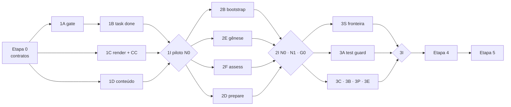

# Plano de construção do generic-harness

> **Fase:** Plan do RPI (cap. 9). Entrada: as pesquisas em `docs/research/`. Saída: etapas com trilhas paralelas, dependências e critérios de saída binários. A spec detalhada de cada etapa é escrita **na hora**, numa janela nova, quando a etapa for a próxima (auto-sizing, cap. 9). Este arquivo não detalha task por task, e isso é proposital (armadilha do cap. 17 e anti-padrão "200 specs antes da primeira linha", GF §10).
> **Hierarquia de fontes:** guia (`ia-first-dev.pdf`, "cap. N") > [HG](../research/harness-generico.md) > [BF](../research/bootstrap-fabrica-de-agentes.md) > [GF](../research/greenfield-do-zero.md). A [avaliação](../research/fabrica-de-agentes-avaliacao.md) entra pelas seções marcadas **[Síntese da avaliação]** do HG.
> **Data:** 30/10/2026.

---

## 0. Resumo

1. **Seis etapas.** A Etapa 0 é sequencial: ela congela os contratos (schemas, CLI, contrato de hook). Depois disso, cada etapa tem de 4 a 6 **trilhas paralelas**, cada uma dona de um diretório, e termina numa **integração** em projeto piloto com critério sim/não.
2. **As etapas seguem as fases do HG §9**, com os acréscimos do BF §13 e do GF §13. A fase 0 do HG ficou grande demais depois desses acréscimos, então foi dividida em duas etapas: **loop mínimo** (Etapa 1) e **bootstrap** (Etapa 2). É o P14: um percurso verificável antes da infraestrutura.
3. **O que permite paralelizar são os contratos, não a quantidade de agentes.** As trilhas programam contra JSON Schema e fixtures da Etapa 0, sem esperar a implementação umas das outras. Uma mudança de contrato durante uma etapa passa por um procedimento próprio (seção 2.3).
4. **No máximo ~3 workers ao mesmo tempo** (cap. 11). Quando a etapa tem mais de 3 trilhas, elas rodam em ondas. A seção 9 mostra o agrupamento para quem trabalha sozinho com agentes.
5. **Antes da Etapa 1, só uma decisão bloqueia: os pilotos** (D5/D21/D45). As demais decisões abertas foram assumidas pela recomendação da própria pesquisa (seção 1) e podem ser trocadas.

---

## 1. Decisões assumidas

As pesquisas deixam D1–D45 abertas. O plano adota a recomendação de cada uma. Esta tabela traz só as que mudam a forma do plano. Para trocar uma delas, edite a linha e revise as etapas citadas.

| # | Decisão assumida | Afeta |
| --- | --- | --- |
| D1 | Claude Code primeiro; Cursor e Codex na Etapa 3 | trilhas C |
| D2, D14 | Vendorizar + `harness.lock`; `bootstrap.py --target` serve o clone dentro e fora do hospedeiro; `BOOTSTRAP.md` para o agente | 2B |
| D3, D24 | Spec nativa mínima; adaptadores OpenSpec + TLC na Etapa 4; Spec Kit na Etapa 5 | 4S, 4F |
| D4 | Python 3 só com stdlib no que vai para o hospedeiro | todas |
| D6 | Matchers neutros `shell:<glob>` / `write:<glob>` | 3S |
| D7, BF §6.2 | Layout do BF: `.harness/work/<ID>/`, `archive/`, `reports/`; `docs/agents/` e `docs/decisions/` fora de `.harness/` | E0 |
| D8, D13 | Fábrica de **software** no repo hospedeiro; agentes-produto (HG §14) ficam fora | escopo |
| D15 | `.agents/skills` canônico, com cópia para `.claude/skills` | 1C, 3C |
| D19 | Comandos do repo só rodam depois que a pessoa aprova a lista | 2B |
| D29–D31 | 4 tiers (`fast`/`standard`/`strong`/`frontier`); roster entregue por fase; só `verifier` e `judge` pinados por ID | 1C, 2D |
| D35–D38 | Greenfield como ramo do `harness-prepare`; `origin: decision:<ADR>` e `status: planned/verified`; ADR MADR com bloco `profile` | E0, 2E |

**Bloqueante, a decidir antes da integração da Etapa 1:**

| # | O que escolher | Uso |
| --- | --- | --- |
| D5, D21 | **Piloto BF-N0**: repo real, sem estrutura de IA, com testes que rodam. **Piloto BF-N1**: repo real com AGENTS.md/CLAUDE.md, em outra linguagem | Etapas 1–3 |
| D45 | **Piloto GF-G0**: diretório vazio numa terceira stack | Etapas 2–3 |

**Decisões que a Etapa 0 precisa tomar** (as pesquisas deixaram em aberto ou se contradizem):

| # | Pergunta | Proposta |
| --- | --- | --- |
| E0-a | `harness <cmd>` (HG) ou `bootstrap.py <cmd>` (BF/GF)? | **Um só CLI**, `harness`, com subcomandos. `bootstrap.py` fica na raiz do generic-harness como *shim* do primeiro uso, e o hospedeiro recebe `.harness/bin/harness` |
| E0-b | Nome da skill de onboarding: `harness-onboard` (HG) ou `factory-onboard` (BF)? | **`harness-onboard`**, para manter o prefixo do harness. As 6 skills do teto (HG §3.2) ficam: `execute`, `prepare`, `spec`, `onboard`, `review`, `retro` |
| E0-c | Fronteira de confiança (D9, HG §3.7): quem escreve `tasks.json`, baselines e evidência? | Fase 0: só o CLI escreve; deny de Write/Edit nesses caminhos; **limites declarados** (o shell ainda alcança). Fase 1: proteção do shell e testes de contorno (3S). Nenhuma etapa anuncia uma garantia que ainda não demonstrou |
| E0-d | Testes do próprio repo | `pytest` só como dependência de desenvolvimento, com JUnit (para usar o próprio test guard no repo). O código vendorizado continua stdlib |

---

## 2. Como o paralelismo funciona

### 2.1 Trilhas e donos de diretório

Cada trilha é dona de um diretório. Duas trilhas paralelas não editam o mesmo diretório. Quando uma precisa de algo da outra, usa o contrato e um stub.

| Trilha | Tema | Diretório dono |
| --- | --- | --- |
| **A** | Sensores de execução: gate, evidência, test guard, `task done`, estado | `core/cli/{gate,task,state,guard}/`, `core/lib/` |
| **S** | Segurança e fronteira de confiança: boundaries-as-code, proteção dos insumos de aceite | `core/cli/boundary/`, `tests/bypass/` |
| **B** | Bootstrap: detect, plan, apply, assess, doctor, update | `core/cli/bootstrap/` |
| **C** | Adaptadores e hooks por ferramenta | `adapters/<ferramenta>/`, `core/hooks/` |
| **D** | Conteúdo: skills, prompts de papéis, templates | `core/skills/`, `core/roles/`, `core/templates/` |
| **E** | Greenfield: gênese, scaffold, features, exemplares | `core/cli/genesis/`, `core/catalog/scaffolders/` |
| **F** | Catálogos de dados e adaptadores de spec | `core/catalog/{readiness,suggestions,patterns}/`, `core/spec-adapters/` |
| **G** | Fixtures, contract tests, evals | `tests/fixtures/`, `tests/contract/`, `evals/` |

### 2.2 Regras de execução

- **Uma trilha, uma worktree, uma branch** (`etapa-N/<trilha>`). M6 do HG: worktrees para paralelismo.
- **Cada trilha faz o RPI dela.** Spec curta em `docs/plan/etapa-N/<trilha>.md`, implementação numa janela nova, gate verde. Até a Etapa 1 terminar, o gate é o `pytest` do repo. Daí em diante, é o próprio `harness gate` (dogfooding, seção 8).
- **Integração no fim de cada etapa**, numa janela só, sequencial: merge das trilhas, piloto e critério de saída.
- **A etapa seguinte só começa depois do critério de saída da anterior** (HG §9). Enquanto a integração acontece, já dá para adiantar duas coisas: a spec da próxima etapa e fixtures. Código, não.

### 2.3 Mudança de contrato durante uma etapa

Os schemas da Etapa 0 são o que torna as trilhas independentes. Se uma trilha descobre que o contrato está errado:

1. ela para e registra a proposta em `docs/plan/contract-changes.md`;
2. a pessoa aprova;
3. o schema sobe de versão e o exemplo e a fixture são atualizados num commit isolado;
4. as outras trilhas fazem rebase.

Mudar o contrato em silêncio dentro de uma trilha é o "Tudo no Mesmo Processo" do cap. 13 em escala de time.

---

## 3. Etapa 0: decisões e contratos (sequencial)

**Por que sequencial:** todas as trilhas dependem destes artefatos. É pouco trabalho, mas define o resto.

| ID | Entrega | Refs |
| --- | --- | --- |
| 0.1 | Confirmar a seção 1 e escolher os pilotos | HG §12, BF §12, GF §12 |
| 0.2 | Esqueleto do repo: `AGENTS.md` (< 100 linhas) com as regras para desenvolver o harness, layout HG §8.1, `pyproject` de dev, CI com matriz Linux/macOS/Windows rodando `pytest --junitxml` | HG §8.1, §8.2 (Windows) |
| 0.3 | **JSON Schemas v0**, com um exemplo válido e um inválido para cada um: `profile.json` (origens e status do BF/GF, `models`/`roles` com 4 tiers, `spec`, `exemplars`, `components`, `limits`), `inventory.json`, `tasks.json`, `features.json`, manifesto de run (HG §3.7), `harness.lock`, item de intake | HG §3.1, §3.7; BF §6.3, §16.7; GF §4.1, §7.1 |
| 0.4 | **Contrato de hook neutro**: JSON normalizado na entrada, exit code e mensagem para o agente (P15) na saída. Eventos: `pre_tool`, `post_edit`, `stop`, `session_start`, `pre_compact` | HG §1.4, §4.1 |
| 0.5 | **Superfície do CLI**: subcomandos, códigos de saída, formato da saída enxuta (HG §3.5), `--json` em tudo | HG §3.2, §3.5; E0-a |
| 0.6 | Formato dos **catálogos**: check de prontidão (BF §15.2), scaffolder (GF §6.2), sugestão (BF §10.1) | P3 do HG |
| 0.7 | **Spike de verificação do Claude Code** (só leitura da doc atual): eventos e formato dos hooks, campos de sub-agent (`model`, `effort`, `tools`, `disallowedTools`), skills e campos extras. Resultado em `docs/plan/etapa-0/claude-code-facts.md` | HG §4.1 e BF §16.4 não foram revalidados |
| 0.8 | Registrar E0-a…E0-d como ADRs do próprio repo em `docs/decisions/` | cap. 7 |

**Critério de saída (sim/não):**
- [ ] Os schemas validam seus exemplos válidos e rejeitam os inválidos (`pytest`).
- [ ] Todas as trilhas da Etapa 1 têm, para o que consomem, schema, exemplo e stub.
- [ ] Os pilotos estão escolhidos e registrados (ou a falta deles está registrada como blocker da integração 1I).
- [ ] O CI do repo está verde nos três sistemas operacionais.

---

## 4. Etapa 1: loop mínimo verificável (M0a)

**Objetivo:** num piloto brownfield real, com o **perfil escrito à mão**, uma task pequena percorre o cap. 17 e é bloqueada se tentar terminar com vermelho. Ainda sem bootstrap automático. É o núcleo da fase 0 do HG.

### Trilhas paralelas

| ID | Trilha | Entrega | Componentes | Depende de |
| --- | --- | --- | --- | --- |
| **1A** | Gate e evidência | parser JUnit (`core/lib/junit`); `harness gate <ID>` lendo comandos do perfil; resumo enxuto + log em `runs/`; hash da árvore **com mudanças não comitadas**; manifesto por tentativa; recusa de verde antigo; comando `planned` = **sensor ausente** (GF §4.2) | S1 | 0.3, 0.5 |
| **1B** | Tarefa e estado | `harness task done <ID>`: roda o gate, grava `tasks.json` de forma atômica, anexa evidência a `validation.md`, sugere o commit; journal + reconciliação depois de interrupção; registro de blocker; atualização do `STATE.md` | S2, M1, M2 | 0.3 (manifesto), stub de 1A |
| **1C** | Render e adaptador Claude Code | `harness render`: blocos BOUNDARIES e Workflow no AGENTS.md, idempotentes; Stop hook (S4) com limite de reentradas, que deixa encerrar com blocker registrado; merge em `.claude/settings.json` sem perder o que já existe; geração de `.claude/agents/harness-{implementer,verifier}.md` a partir de `core/roles/` + perfil (o verifier pinado); cópia das skills com os campos extras | G1, S4 | 0.4, 0.7 |
| **1D** | Conteúdo | skill `harness-execute` (loop L1 e árvore de decisão do cap. 11); prompts `core/roles/{implementer,verifier,explorer}.md` (verifier: check binário, `arquivo:linha`, sem evidência = não atendido); templates `STATE.md`, task com DoD, `validation.md`; esqueleto de AGENTS.md com TODOs (G2) | G2, G4, G9, S7 | 0.3 |
| **1G** | Fixtures | repo-fixture mínimo na stack do piloto N0; testes de cenário: gate vermelho bloqueia o Stop, verde antigo é recusado, interrupção entre gate e persistência não gera conclusão, comando `planned` bloqueia `task done` | — | 0.3 |

**Ondas para 3 workers:** {1A, 1B} → um worker, em sequência (o 1B usa o 1A de verdade assim que ele sai); {1C}; {1D, 1G}.

### Integração 1I (sequencial)

No piloto BF-N0: perfil manual, `harness render`, uma task pequena real, tentativa deliberada de encerrar com vermelho.

**Critério de saída (HG §9 fase 0 + HG §9.1):**
- [ ] Gate com exit 0 associado ao hash da árvore atual; o manifesto identifica a tentativa, as entradas e os comandos.
- [ ] `validation.md` tem evidência `arquivo:linha` do verifier, que roda em sub-agent pinado.
- [ ] `STATE.md` foi atualizado com handoff.
- [ ] A tentativa de encerrar com gate vermelho **foi bloqueada**.
- [ ] Um verde antigo, depois de uma edição, é recusado.
- [ ] Os limites conhecidos da proteção estão escritos (E0-c), sem prometer o que a fase 1 ainda vai demonstrar.

---

## 5. Etapa 2: bootstrap e gênese mínimos (M0b)

**Objetivo:** o perfil deixa de ser manual. O harness se instala sozinho num repo N0/N1 e cria um projeto G0 do zero até o esqueleto andante. Cobre o resto da fase 0 (BF §13 e GF §13).

### Trilhas paralelas

| ID | Trilha | Entrega | Refs | Depende de |
| --- | --- | --- | --- | --- |
| **2B** | Bootstrap | `harness detect` (somente leitura: stack das 3 stacks dos pilotos, IA existente N0–N4, classe G0–G3, runtimes, ferramentas de IA, provedor, sub-agents do time) → `inventory.json`; `plan` (dry-run com diff); aprovação da lista de comandos; `apply` para N0 e N1 (estrutura do BF §6.2, blocos, adaptador, lock, `.gitignore`), idempotente; `bootstrap.py --target`; `BOOTSTRAP.md` | BF §3–6, §9; GF §3 | Etapa 1 |
| **2F** | Prontidão | catálogo de checks computacionais P0–P1 (R01–R04, R05, R06, R10–R14, R16, R17); `harness assess` → `readiness.{md,json}`, determinístico; `harness backlog` → `intake/READY-NNN.md` a partir de `fix.recipe` | BF §15.2; GF §9.4 | 0.6 |
| **2D** | Orquestração e roster | skill `harness-prepare`: lê o estado em disco, executor por passo, para nos pontos humanos, janela < 40%, profundidade 2, resultado por referência; `references/greenfield.md`; papel `explorer` (`fast`, só leitura); `reports/agents.md` com o modelo **resolvido** | BF §15.7, §16; GF §9 | 1D, 1C |
| **2E** | Gênese mínima | templates `brief.md`, ADR MADR de fundação com bloco `profile`, RFC; catálogo de scaffolder **só para a stack do piloto G0**, com template de CI; `harness scaffold <id>` com aprovação; DoD fixa do `GEN-001`; `harness gate --prove-sensor` (vermelho → verde por mutação, R05) | GF §4–6 | 1A (o gate) |

**Ponto de atrito:** o `--prove-sensor` do 2E mexe no diretório do 1A. Ele entra como módulo separado (`core/cli/gate/prove_sensor.py`), chamado pelo gate, e o gate não muda de interface.

**Ondas para 3 workers:** {2B}; {2F, 2E}; {2D}.

### Integração 2I: duas integrações em paralelo

| Piloto | Percurso | Critério (sim/não) |
| --- | --- | --- |
| **BF-N0** | detect → plan → aprovar → apply → primeiro READY pela fábrica | [ ] o bootstrap termina com um READY aceito como primeiro loop · [ ] rodar `apply` duas vezes não muda nada na segunda · [ ] rodar `assess` duas vezes dá o mesmo `readiness.json` · [ ] janela principal < 40% e leitura em massa num sub-agent `fast` |
| **BF-N1** | detect → plan → apply | [ ] só os blocos marcados foram tocados · [ ] os conflitos entre arquivos de instrução foram listados, não resolvidos |
| **GF-G0** | classificar → brief → ADRs → apply (comandos `planned`) → `GEN-001` | [ ] CI verde, comandos `verified`, R05 verde · [ ] uma task tentada antes do esqueleto é bloqueada por sensor ausente |

---

## 6. Etapa 3: enforcement e portabilidade (M1)

**Objetivo:** fase 1 do HG. As regras importantes passam a ter enforcement provado, inclusive contra contornos, e o harness roda em mais de uma ferramenta.

| ID | Trilha | Entrega | Refs |
| --- | --- | --- | --- |
| **3A** | Test guard | `harness task freeze` (hash dos testes da fase red); contagem contra o baseline; skips e `skipMarkers`; task sem teste (`noTests` aprovado); modo degradado declarado; válvula **ask** que registra a aprovação no STATE | S3; HG §3.5 |
| **3S** | Fronteira de confiança | compilação de `never`/`ask` para deny/ask + hook; proteção de `tasks.json`, scripts, perfil, baselines e evidência **também pelo shell**; suíte `tests/bypass/` com as tentativas de contorno; declaração de cobertura e lacunas por adaptador | S5; HG §3.7, §7.1 |
| **3C** | Adaptadores Cursor e Codex | spike de verificação da doc atual (como o 0.7); hooks, `cli.json`, arquivos de agents e diretórios de skills; SessionStart (≤ 20 linhas) e PreCompact nas três ferramentas; **contract tests**: o mesmo evento neutro produz a mesma decisão | M3, M5; HG §4, §7.2 |
| **3B** | Bootstrap completo | N2–N4 (coexistir, compor hooks, relatar conflitos); matriz de detecção com fixture para **≥ 3 ecossistemas**; `uninstall`; `harness doctor` (tamanho, ponteiros, comandos, blocos dessincronizados, frescor, checks de agentes, estimativa de contexto fixo) | S9; BF §4.2, §5, §16.8 |
| **3P** | Preparação e aprendizado | skills `harness-onboard` e `harness-retro`; captura de padrões (explorers → synthesizer → `patterns.md` com evidência e contra-exemplos); linter de AGENTS.md (metade computacional e metade inferencial); diffs de poda; papéis `researcher`, `synthesizer`, `auditor`, `planner`, `mechanical`, `doc-writer`, `retro` | G6, G8; BF §15.3–15.4 |
| **3E** | Gênese completa | Design It Twice (`researcher` × 3 → RFC); `profile from-adrs`; `features.json` + `harness feature`, com status só pelo script; exemplares canônicos + `code-patterns.md`; `genesis exit` (GF §8.1); scaffolders para ≥ 3 ecossistemas | GF §5.3, §7, §8 |

**Ondas para 3 workers:** primeiro o enforcement {3A, 3S, 3C}; depois {3B, 3P, 3E}. O 3S vem cedo porque ele valida a promessa que o 1B fez em E0-c.

**Critério de saída (HG §9 fase 1 + HG §9.1 + BF §13 + GF §13):**
- [ ] As 4 trapaças do iceberg reprovam o gate nas fixtures.
- [ ] A suíte de contorno roda; cada caminho está bloqueado, detectado ou declarado como lacuna.
- [ ] A mesma task piloto passa no Claude Code **e** no Cursor; os contract tests estão verdes.
- [ ] O `doctor` acusa referência quebrada e comando inexistente.
- [ ] Piloto BF-N1: nenhum arquivo do time alterado fora dos blocos; os agentes do time foram adotados ou mantidos; o diff de poda reduz o AGENTS.md sem remover comando nem boundary aprovado.
- [ ] Todo candidato em `patterns.md` tem `arquivo:linha`.
- [ ] Piloto GF-G0: a primeira fatia termina com exemplares declarados; a transição para brownfield acontece pelos checks da GF §8.1, sem editar o perfil à mão; as fixtures de ≥ 3 geradores passam no R05.

---

## 7. Etapas 4 e 5 (detalhar quando forem as próximas)

### Etapa 4: spec e orquestração (M2, fase 2 do HG)

| ID | Trilha | Entrega |
| --- | --- | --- |
| **4O** | Orquestração L2/L3 | workers por blocos de fases (≤ 3, em sequência quando há dependência); Planner → Generator → Evaluator; fix loop até `maxFixIterations`; `fallbackTier` uma vez e depois o humano; custo por papel no STATE |
| **4S** | Spec nativa | `harness-spec` com auto-sizing, WHEN/THEN/SHALL, IDs; validador estrutural; `spec archive` preservando ponteiros para a evidência (M7) |
| **4R** | Review local | `harness-review`: `reviewer` por especialidade, `security`, `consolidator`; `docs/agents/review/*` a partir dos padrões aceitos; intake + `triager`; template de PR com ID |
| **4F** | Camada de spec plugável | escolha guiada → ADR 0001; adaptadores **OpenSpec** e **TLC** (leitura de tasks e critérios, injeção da regra de DoD, fonte única de contexto); checks P2–P3 |
| **4E** | Gênese avançada | modo spike; caso híbrido G3 em monorepo; backlog espelhado do board |

**Critério de saída:** uma feature de ~10–18 tasks termina com **pico da janela principal < 40%**, nenhum worker por task, toda task concluída via `task done` e custo registrado por papel. Uma change num framework externo passa pelo validador nativo, pelo gate e pelo verifier (R20, R21). Rastreabilidade até a entrega e acesso às provas depois do arquivamento. Num monorepo, um pacote G3 passa pela gênese sem alterar o perfil raiz.

### Etapa 5: medir e automatizar (M3, fase 3 do HG)

| ID | Trilha | Entrega |
| --- | --- | --- |
| **5V** | Evals | fixtures em 3–4 stacks com PRD; baseline congelado; `judge` pinado; `score.py`; pass@k/pass^k; ambiente limpo a cada trial; ablação por componente, por tier do `implementer`, com e sem exemplares, com e sem prova do sensor |
| **5CI** | Review no CI | GitHub Actions: `/review` → humano decide → `/fix` → commit pelo workflow; deny de commit/push para a IA |
| **5L** | Runner L6 | headless, agenda/evento, worktrees, orçamento; os cenários de falha da HG §3.8 como testes |
| **5S** | Sensores contínuos | drift de arquitetura, ciclos, código morto, discrimination sensor |
| **5U** | Ciclo de vida | `update` com merge de 3 vias à moda Copier; `suggest` com catálogo externo e campo de confiança; histórico de prontidão; `doctor` no CI; adaptador Spec Kit |
| **5E** | Greenfield autônomo | modo Young/Rajasekaran sobre o 5L, com brief e backlog revisados por humano |

**Critério de saída:** ganho sobre "sem harness" em ≥ 2 stacks, com vários runs por configuração; a ablação identifica ao menos um componente desligável e compara dois tiers do `implementer` em custo por task concluída; atualizar o harness num piloto preserva as edições locais; o runner cumpre os cenários da HG §3.8; o juiz foi calibrado contra avaliação humana.

---

## 8. Caminho crítico e dogfooding

- **Caminho crítico:** contratos → gate → `task done` → piloto N0 → bootstrap → integração 2I → fronteira de confiança. Atrasar qualquer um desses atrasa tudo. As outras trilhas têm folga.
- **Dogfooding a partir da Etapa 2:** depois da 1I, o generic-harness instala a si mesmo (`harness apply --target .`). Daí em diante, as trilhas concluem as próprias tasks com `harness task done`, e cada erro do harness aparece primeiro aqui. O repo do harness **não substitui** os pilotos: ele é Python e foi escrito por quem conhece o harness, então é um piloto enviesado.

---

## 9. Execução para uma pessoa com agentes

Com o teto de ~3 workers do cap. 11, uma rodada por etapa fica assim:

| Etapa | Janela principal (orquestra, fica < 40%) | Worker 1 | Worker 2 | Worker 3 |
| --- | --- | --- | --- | --- |
| 0 | tudo, em sequência | — | — | — |
| 1 | specs das trilhas, depois a integração 1I | 1A → 1B | 1C | 1D + 1G |
| 2 | specs, depois 2I (N0 e G0 podem ir em janelas separadas) | 2B | 2F → 2E | 2D |
| 3 | specs, depois 3I | 3A → 3B | 3S → 3E | 3C → 3P |
| 4 | idem | 4O | 4S → 4F | 4R → 4E |
| 5 | idem | 5V | 5L → 5E | 5CI → 5S → 5U |

Cada worker roda numa worktree própria, com o papel `implementer` (`standard`). A spec da trilha vem do `planner` (`strong`) e é revisada pela pessoa antes. O verifier confere o critério da trilha antes do merge. Os pontos humanos são os mesmos do P10: revisar a spec, revisar o diff e decidir o que fazer com os achados.

---

## 10. Riscos do plano

| Risco | Mitigação |
| --- | --- |
| Contrato errado descoberto no meio da etapa trava as trilhas | Exemplos válidos e inválidos na Etapa 0; procedimento da 2.3; v0 assumida como provisória até a 1I |
| Etapa 1 cresce e vira "infraestrutura antes da task" | Perfil manual; uma ferramenta; sem test guard nem detecção; o critério é o da HG §9 fase 0, nada além |
| Fatos de ferramenta desatualizados (HG §4.1 e BF §16.4 não foram revalidados) | Spikes 0.7 e 3C antes de codar o adaptador; contract tests |
| Merge doloroso entre trilhas | Donos de diretório (2.1); integração no fim da etapa; rebase diário na branch da etapa |
| Piloto não escolhido | Bloqueia só a 1I; as trilhas usam fixtures até lá |
| Prometer enforcement que ainda não existe | E0-c: limites declarados na fase 0; 3S prova ou declara lacuna |

---

## 11. Próximo passo

1. Revisar a seção 1, principalmente E0-a…E0-d, e escolher os três pilotos.
2. Numa **janela nova**, escrever `docs/plan/etapa-0/spec.md` a partir da seção 3 e executá-la.
